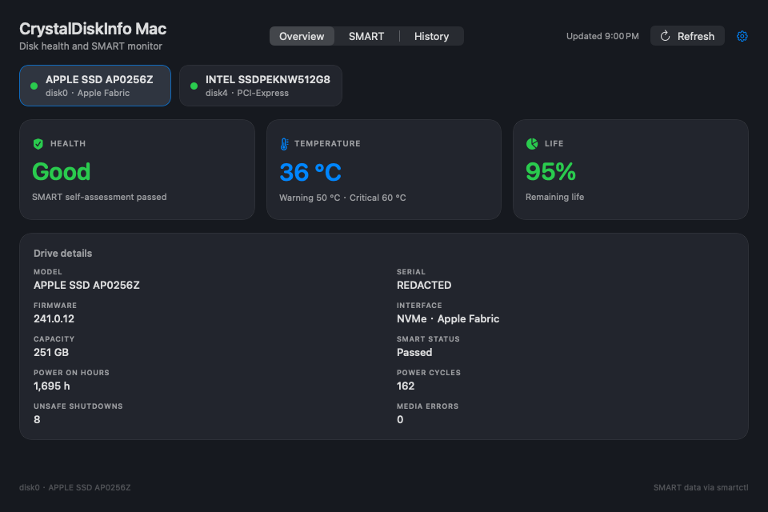

# CrystalDiskInfo Mac

> **Unofficial native macOS port** inspired by [CrystalDiskInfo](https://crystalmark.info/) (MIT, hiyohiyo). Not affiliated with or endorsed by CrystalMark.

A native macOS disk-health app inspired by CrystalDiskInfo. It discovers local
physical disks, reads SMART data through `smartctl`, and shows health,
temperature, remaining life, identity, SMART attributes, history, menu-bar
status, and alerts.



## Features

- Physical-disk discovery through `diskutil`; APFS synthesized volumes and disk
  images are excluded.
- Health, temperature, and life cards for every disk.
- Model, serial, firmware, protocol, capacity, power-on hours, power cycles,
  unsafe shutdowns, and media errors.
- Sortable SMART attribute table with raw values and prefailure warnings.
- 30-day history with 1h / 24h / 7d / 30d ranges and gaps for missing samples.
- Menu-bar extra with per-disk health, temperature, and life; Open, Refresh,
  Settings, and Quit actions.
- Transition-based notifications for health, temperature, two consecutive
  Unknown reads, and disk removal after two misses.
- Native Settings window: refresh interval, temperature policy, menu-bar
  temperature, notifications, launch at login, and smartctl status.
- English UI, native dark/light appearance, 960×640 main window.

## Requirements

- macOS 14 (Sonoma) or later, Apple Silicon (`arm64`).
- `smartctl` 7.4 or later, installed separately:

```sh
brew install smartmontools
```

The app checks `/opt/homebrew/bin/smartctl`, `/usr/local/bin/smartctl`,
`/usr/bin/smartctl`, then `PATH`. `smartctl` is not bundled.

## Download or build

### Homebrew Cask (Recommended)

```sh
brew install --cask zxu756/tap/crystaldiskinfo-mac
```

### Prebuilt release

Download `CrystalDiskInfoMac-v0.1.0-macos-arm64.zip` from [Releases](https://github.com/zxu756/CrystalDiskInfoMac/releases), move `CrystalDiskInfoMac.app` to `/Applications`, and clear the quarantine attribute before first launch (ad-hoc signed, not notarized):

```sh
xattr -cr /Applications/CrystalDiskInfoMac.app
```

### Build from source

```sh
swift test
Scripts/build-app.sh
open build/CrystalDiskInfoMac.app
```

The build is ad-hoc signed and is not notarized. The app is not sandboxed and is
not distributed through the App Store.

To regenerate the icon:

```sh
swift Scripts/make-icon.swift
```

## Test

```sh
swift test
```

The suite covers smartctl JSON decoding, process execution and timeout
semantics, disk enumeration, health/temperature/life rules, history retention,
monitor refresh behavior, notification policy, menu-bar summaries, settings,
and SwiftUI rendering. It currently runs with the Command Line Tools Swift
toolchain only.

## Health rules

The evaluator computes every applicable signal and applies the maximum
severity: **Bad > Caution > Unknown > Good**.

- `smart_status.passed == false` → Bad.
- NVMe:
  - nonzero `critical_warning` → Bad;
  - `available_spare < available_spare_threshold` → Bad;
  - spare equal to a non-100 threshold → Caution;
  - `media_errors > 0` → Caution;
  - `percentage_used >= 90` → Caution; `>= 100` → Bad.
- ATA:
  - prefailure attribute with a nonzero threshold and `current <= threshold` →
    Bad;
  - reallocated, pending, or offline-uncorrectable raw value > 0 → Caution.
- Temperature at or above the critical limit → Bad; at or above the warning
  limit → Caution.

`Unknown` means SMART itself was unreadable. A readable drive with missing
optional sensors still gets a conclusion from the signals that are present.

### Temperature

Drive-reported `op_limit_max` / `critical_limit_max` are used by default.
Drives without reported limits use the global 50 °C warning / 60 °C critical
values. The Settings toggle **Use drive-reported limits** switches every drive
to the global values; the global values remain editable.

### Life

- NVMe: `max(0, 100 - percentage_used)`.
- ATA: the first available lifetime attribute among `Percent_Lifetime_Remain`,
  `Media_Wearout_Indicator`, `SSD_Life_Left`, `Remaining_Lifetime_Perc`.
- If neither is available, the UI shows `—`. Power-on hours never imply life.

### smartctl exit status

A nonzero smartctl exit with usable JSON is still parsed. On this Mac the
internal Apple SSD exits 4 while returning complete identity and SMART data;
that is a diagnostic, not a failed read. Only an open failure, timeout, or
unparseable/missing payload produces `Unknown`.

## History

History is stored locally at:

```text
~/Library/Application Support/CrystalDiskInfoMac/history/
```

One JSON file is written per stable serial/model id. Retention is 30 days with a
hard cap of 100,000 samples per disk. Missing samples are rendered as gaps, not
as zero.

## Notifications

The first observation of a disk only establishes a baseline, so a pre-existing
Bad state does not alert on launch. Repeated Bad states do not re-alert.
Unknown and removal alerts require two consecutive observations. Notification
permission is requested lazily when the first alert is delivered.

## Permissions and unsupported devices

- Some devices require Full Disk Access for CrystalDiskInfo Mac in System
  Settings → Privacy & Security. A permission failure is shown with that
  guidance; no healthy data is fabricated.
- USB bridges may require a specific smartctl device type. The app retries
  `-d sat` and `-d nvme` only.
- RAID, AAM/APM, vendor USB quirks, themes, localization, and privileged
  helpers are out of scope for v1.
- All processing is local. The app makes no network requests.

## Attribution

- Inspired by [CrystalDiskInfo](https://crystalmark.info/) (MIT, hiyohiyo).
  Not affiliated with CrystalMark.
- Uses the separately installed [smartmontools](https://www.smartmontools.org/)
  / `smartctl` (GPLv2). `smartctl` is not bundled.
- App code is MIT; see `LICENSE` and `NOTICE`.
- The app icon is original artwork generated by `Scripts/make-icon.swift`; it
  does not use the CrystalDiskInfo logo.
